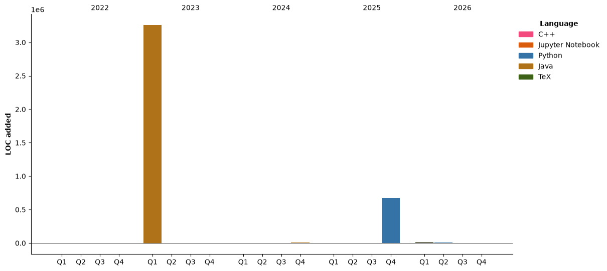

## ⏱ This Week I Spent My Time On

<!--START_SECTION:waka-->


**🐱 My GitHub Data** 

> 📦 498.6 kB Used in GitHub's Storage 
 > 
> 🏆 157 Contributions in the Year 2026
 > 
> 🚫 Not Opted to Hire
 > 
> 📜 22 Public Repositories 
 > 
> 🔑 4 Private Repositories 
 > 
**I'm an Early 🐤** 

```text
🌞 Morning                228 commits         █████████████░░░░░░░░░░░░   53.27 % 
🌆 Daytime                66 commits          ████░░░░░░░░░░░░░░░░░░░░░   15.42 % 
🌃 Evening                100 commits         ██████░░░░░░░░░░░░░░░░░░░   23.36 % 
🌙 Night                  34 commits          ██░░░░░░░░░░░░░░░░░░░░░░░   07.94 % 
```
📅 **I'm Most Productive on Saturday** 

```text
Monday                   48 commits          ███░░░░░░░░░░░░░░░░░░░░░░   11.21 % 
Tuesday                  57 commits          ███░░░░░░░░░░░░░░░░░░░░░░   13.32 % 
Wednesday                20 commits          █░░░░░░░░░░░░░░░░░░░░░░░░   04.67 % 
Thursday                 40 commits          ██░░░░░░░░░░░░░░░░░░░░░░░   09.35 % 
Friday                   28 commits          ██░░░░░░░░░░░░░░░░░░░░░░░   06.54 % 
Saturday                 197 commits         ████████████░░░░░░░░░░░░░   46.03 % 
Sunday                   38 commits          ██░░░░░░░░░░░░░░░░░░░░░░░   08.88 % 
```


📊 **This Week I Spent My Time On** 

```text
🕑︎ Time Zone: America/New_York

💬 Programming Languages: 
Other                    0 secs              ███████████████████████░░   91.29 % 
Python                   0 secs              ██░░░░░░░░░░░░░░░░░░░░░░░   08.71 % 

🔥 Editors: 
Claude Code              1 min               █████████████████████████   100.00 % 

💻 Operating System: 
Mac                      0 secs              █████████████████████████   100.00 % 
```

🤖 **AI Coding This Week** 

```text
⏱ AI Coding Time: 0 secs (100.0%)

✍️ 0 lines written by AI, 0 lines written by hand (0% AI-written)

🔤 234,688 Input Tokens, 2,355 Output Tokens

💵 $37.58 Estimated AI Cost This Week

🧠 1 AI Sessions, 1 AI Prompts

Opus                     297 lines           ███████████████████████░░   92.24 % 
Fable                    25 lines            ██░░░░░░░░░░░░░░░░░░░░░░░   07.76 % 

🔎 AI Coding Insights:
🧑‍💻 Mostly Hands-On — 0% of written lines came from AI
📝 Concise Prompter — average 38 characters per prompt
🎯 One-Shot Prompter — average 1 prompts per session
🚀 High AI Trust — 0% of changed lines were hand-edited
```

**I Mostly Code in Python** 

```text
Python                   13 repos            ████████████░░░░░░░░░░░░░   46.43 % 
Java                     7 repos             ██████░░░░░░░░░░░░░░░░░░░   25.00 % 
Jupyter Notebook         5 repos             ████░░░░░░░░░░░░░░░░░░░░░   17.86 % 
C++                      2 repos             ██░░░░░░░░░░░░░░░░░░░░░░░   07.14 % 
Go                       1 repo              █░░░░░░░░░░░░░░░░░░░░░░░░   03.57 % 
```


**Timeline**




 Last Updated on 01/11/2026 05:58:28 UTC
<!--END_SECTION:waka-->
